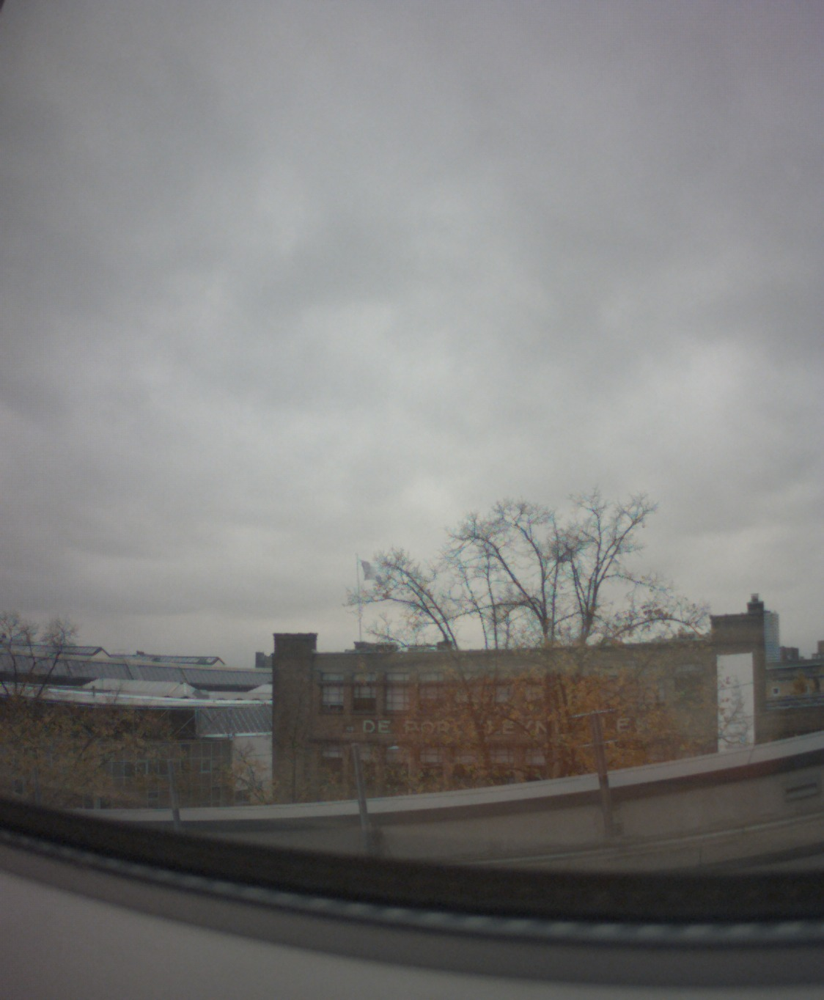
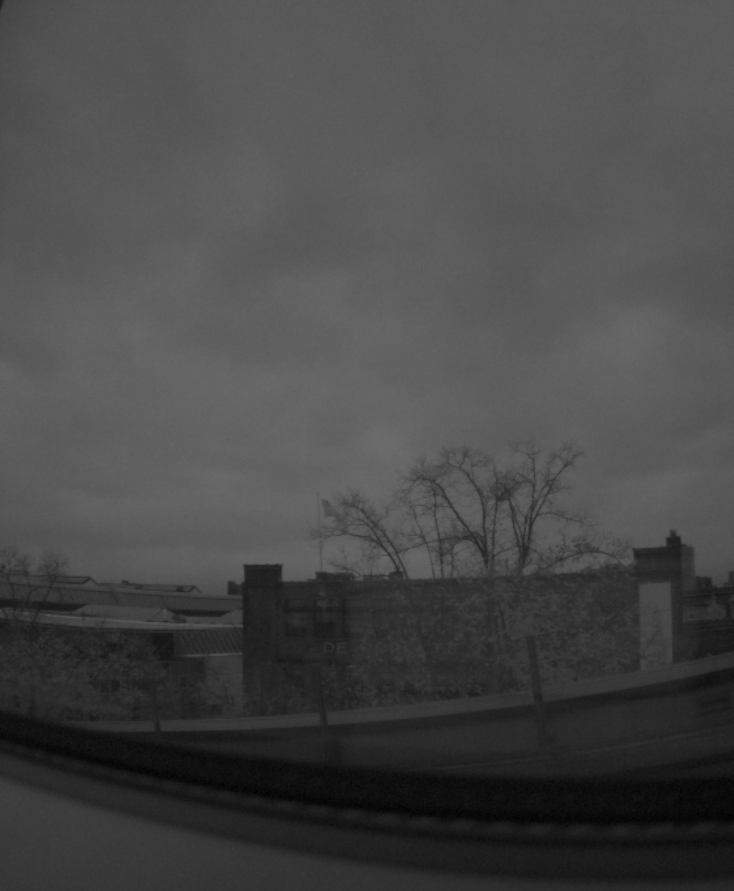
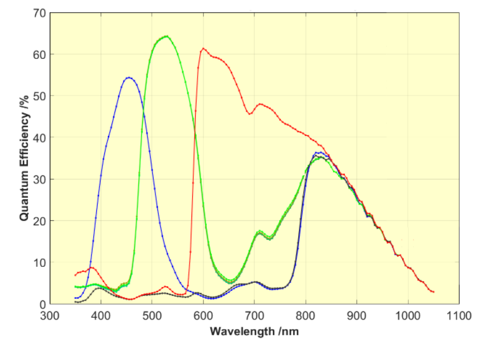
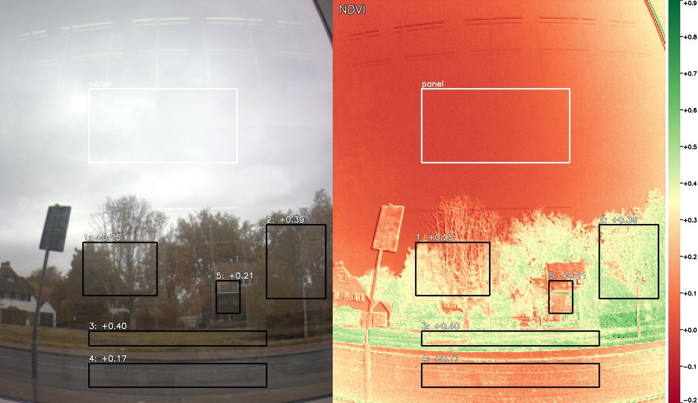

# RGBIR_VD16GZ

Use the ST **VD16GZ** RGB-IR global shutter sensor on a **Raspberry Pi 5** as two ordinary
V4L2 cameras: one colour (RGB) and one near-infrared (IR). Any program that can open a webcam
(OpenCV, GStreamer, ffmpeg, a browser) can read them, and both come from the same exposure.

| Device | Format | Content |
|---|---|---|
| `/dev/vd16gz-rgb` | RGB24, 1124 x 1364, 60 fps | colour image |
| `/dev/vd16gz-ir` | GREY, 1124 x 1364, 60 fps | near-infrared image |
| `/dev/vd16gz-raw` | Y16, 1124 x 1364, 60 fps | unprocessed 4x4 RGB-IR mosaic, 10-bit values |
| `/dev/vd16gz-sensor` | V4L2 sub-device | exposure, gain, frame rate, ... |

Everything needed is in this repository. ST's STSW-IMG504 package does not have to be
downloaded separately, because the ST driver source is included in [`driver/`](driver).

Made by Daan Boesten on 21 October 2026, together with Claude Opus 5.5 (Anthropic).

| RGB (`/dev/vd16gz-rgb`) | IR (`/dev/vd16gz-ir`) |
|---|---|
|  |  |

*One sensor frame at full resolution (1124 x 1364), split by vd16gz-bridge into RGB and IR;
both images have the same timestamp. Default settings: auto exposure, NIR removed from RGB
(`rgb - ir`), grey world white balance, no colour calibration.*

## How it works

```
VD16GZ ──CSI-2──> rp1-cfe ──/dev/videoN (Y10P mosaic)──> vd16gz-bridge ──> /dev/vd16gz-rgb
 (vd56g3 driver)                                         (demosaic)      ├─> /dev/vd16gz-ir
                                                                         └─> /dev/vd16gz-raw
```

* **Kernel driver**: ST's `vd56g3` driver (VD56G3 / VD66GY / VD16GZ), built with DKMS so it is
  rebuilt automatically after kernel updates. The driver only has basic VD16GZ support. Linux has
  no format code for RGB-IR mosaics, so the driver reports the sensor as 10-bit greyscale.
* **vd16gz-bridge**: a small C service. It configures the Pi 5 camera pipeline, splits every
  sensor frame into RGB and IR, and writes the images to
  [v4l2loopback](https://github.com/umlaeute/v4l2loopback) devices. Pixels missing from the
  mosaic are interpolated by normalized convolution: G and IR with a 3x3 kernel, R and B with 5x5.
  Measured pixels are kept as they are.
* **Sensor controls**: exposure and gain are set on the sensor itself (`/dev/vd16gz-sensor`),
  also while streaming.

## Installation

Hardware: Raspberry Pi 5 with the VD16GZ camera board (ST adapter PCB4188) on the **CAM0**
or **CAM1** connector. Software: Raspberry Pi OS bookworm, 64-bit.

```bash
git clone https://github.com/smart-sensor-systems-thuas/RGBIR_VD16GZ.git
cd RGBIR_VD16GZ
sudo ./install.sh cam0      # or cam1, the connector the camera is on
sudo reboot
```

After the reboot, `ls /dev/vd16gz-*` shows the four devices. The installer:

* installs `dkms`, kernel headers, `v4l2loopback-dkms` and `v4l-utils`
* builds and installs the `vd56g3` driver with DKMS
* compiles the `pcb4188_vd16gz` overlay and adds `dtoverlay=pcb4188_vd16gz,cam0` to
  `/boot/firmware/config.txt`
* installs `vd16gz-bridge`, its systemd service, the v4l2loopback and udev settings, and the
  Python helper `vd16gz.py`

Remove everything again with `sudo ./uninstall.sh`.

## Raw mosaic or split RGB / IR?

The sensor measures one colour per pixel in a repeating 4x4 pattern (top-left pixel first):

```
G I G I        G : 8 of 16 pixels
B G R G        I : 4 of 16 pixels (near-infrared)
G I G I        R : 2 of 16 pixels
R G B G        B : 2 of 16 pixels
```

The mosaic can be read as it is (`/dev/vd16gz-raw`), or the bridge can turn it into a full
resolution colour image and a full resolution IR image (`/dev/vd16gz-rgb` + `/dev/vd16gz-ir`).
No V4L2 or OpenCV format holds all four colours in one image, so these are the two routes.

| | Raw mosaic (`/dev/vd16gz-raw`) | Split (`/dev/vd16gz-rgb` + `/dev/vd16gz-ir`) |
|---|---|---|
| Content | the measured values, 10-bit (0..1023) | interpolated RGB and IR, 8-bit |
| Data per frame | 3.1 MB (one stream) | 6.1 MB (two streams) |
| Bridge CPU at 60 fps | ~2 ms per frame (unpacking only) | ~14 ms per frame on 4 threads, ~3 cores |
| Values | linear, nothing invented | 3 of 4 values per pixel are estimated; NIR subtracted, white balance and sRGB gamma by default |
| Works with | custom code (NumPy / OpenCV) | any webcam program: OpenCV, GStreamer, ffmpeg, browsers |
| Synchronization | automatic: all four colours are in one image | per frame timestamp, identical on both devices |
| Required knowledge | the 4x4 pattern and the black level (64) | nothing; RGB and IR are ready to use |

**The raw mosaic** suits measurement and analysis of light: spectral ratios (e.g. NDVI-like
indices from R and IR), radiometry, custom demosaicing or machine learning on sensor data,
and applications whose own processing needs the CPU. It also offers 10-bit precision and a
linear response. Disadvantages: the pattern has to be handled in the application, and standard
video tools cannot display it.

**The split devices** suit applications that need ordinary images: viewing, recording,
streaming, calibrated colour, or existing OpenCV/GStreamer code that expects a camera.
Disadvantages: the bridge needs about 3 CPU cores at full resolution (or under 1 core with
`--half`), the values are 8-bit, and full resolution adds sharpness only through interpolation. R and B are sampled
on just 1 in 8 pixels, and IR on 1 in 4.

Both can be combined: the devices are independent, so one program can read raw while another
reads RGB. The bridge only processes what is being read.

### Working with the raw mosaic

OpenCV reads `/dev/vd16gz-raw` as a 16-bit single-channel image. Slicing the channels out
with NumPy creates views without copying, so it costs almost nothing:

```python
import cv2
import numpy as np

cap = cv2.VideoCapture("/dev/vd16gz-raw", cv2.CAP_V4L2)
cap.set(cv2.CAP_PROP_CONVERT_RGB, 0)
ok, raw = cap.read()                                   # (1364, 1124) uint16, 0..1023
lin = np.clip(raw.astype(np.float32) - 64, 0, None)    # remove black level, linear

# Quarter resolution (341 x 281): every value measured, nothing interpolated.
# Each 4x4 block gives one R, G, B and IR value (averages of its samples).
blk = lambda a: a.reshape(341, a.shape[0] // 341, 281, a.shape[1] // 281).mean((1, 3))
R  = (lin[3::4, 0::4] + lin[1::4, 2::4]) / 2
B  = (lin[1::4, 0::4] + lin[3::4, 2::4]) / 2
G  = blk((lin[0::2, 0::2] + lin[1::2, 1::2]) / 2)
IR = blk(lin[0::2, 1::2])
rgbi = np.dstack([R, G, B, IR])                        # 341 x 281 x 4

# Half resolution (682 x 562): G and IR measured in every 2x2 block; each block holds
# only one of R or B (B where row + column of the block is even, R where it is odd).
g_half  = (lin[0::2, 0::2] + lin[1::2, 1::2]) / 2
ir_half = lin[0::2, 1::2]
rb_half = lin[1::2, 0::2]
```

Which resolution to use: quarter resolution gives all four channels without interpolation,
which is best for measurements. Half resolution is a good compromise for most computer vision
(G and IR measured, R/B partly estimated). Full resolution is only sharper through
interpolation; use the split devices for it, because the bridge's C code is much faster than
NumPy. [`tools/capture.py`](tools/capture.py) contains a NumPy full-resolution demosaic
identical to the bridge's, for offline work.

## Using the camera

### OpenCV (Python)

```python
import cv2

rgb = cv2.VideoCapture("/dev/vd16gz-rgb", cv2.CAP_V4L2)
ir = cv2.VideoCapture("/dev/vd16gz-ir", cv2.CAP_V4L2)
while True:
    ok1, colour = rgb.read()   # BGR, as usual in OpenCV
    ok2, nir = ir.read()
    t1 = rgb.get(cv2.CAP_PROP_POS_MSEC)   # sensor timestamp of the frame
    t2 = ir.get(cv2.CAP_PROP_POS_MSEC)
    ...
```

Frames from the RGB and IR devices that belong together have **exactly the same timestamp**
(`CAP_PROP_POS_MSEC`, CLOCK_MONOTONIC). Frames can be paired by this timestamp when a
program falls behind. [`examples/opencv_view.py`](examples/opencv_view.py) shows both images live, with
keys for exposure.

Note: OpenCV converts the IR image to 3 identical channels. Use `nir[..., 0]`, or
`ir.set(cv2.CAP_PROP_CONVERT_RGB, 0)` to get a single channel.

### Exposure, gain and frame rate

From Python ([`tools/vd16gz.py`](tools/vd16gz.py), installed system-wide by `install.sh`):

```python
import vd16gz

cam = vd16gz.Sensor()
cam.set_exposure_us(5000)   # manual exposure, 5 ms
cam.set_gain_x(2.0)         # analogue gain x1..x8 (or cam.set_gain(code), code 0..28)
cam.auto_exposure()         # the sensor's own auto exposure (default)
cam.set_fps(30)             # frame rate via vertical blanking
print(cam.get("exposure"), cam.temperature)
```

or from a shell:

```bash
v4l2-ctl -d /dev/vd16gz-sensor -L                                # list all controls
v4l2-ctl -d /dev/vd16gz-sensor -c auto_exposure=1,exposure=800   # manual, 800 lines
v4l2-ctl -d /dev/vd16gz-sensor -c analogue_gain=8
v4l2-ctl -d /dev/vd16gz-sensor -c auto_exposure=0                # back to auto
```

Exposure is set in lines of 7.69 us (1236 pixels at 160.8 MHz). At 60 fps it can be at most
2093 lines (16.1 ms). For longer exposures, lower the frame rate first.

The analogue gain control takes a code from 0 to 28; the gain factor is 32 / (32 - code), so
code 0 = x1, 16 = x2, 24 = x4 and 28 = x8 (+18 dB). Steps are fine at low gain and coarse at
high gain. `vd16gz.analog_gain_factor()` and `analog_gain_code()` convert between the two.

### GStreamer, ffmpeg

```bash
# record 10 s of RGB and IR to video files
ffmpeg -f v4l2 -i /dev/vd16gz-rgb -t 10 -c:v libx264 -crf 18 rgb.mp4
ffmpeg -f v4l2 -i /dev/vd16gz-ir  -t 10 -c:v libx264 -crf 18 ir.mp4

# show the RGB stream
gst-launch-1.0 v4l2src device=/dev/vd16gz-rgb ! videoconvert ! autovideosink
```

### Live view in a browser

```bash
python3 examples/web_stream.py      # then open http://<pi-address>:8000
```

## Synchronization

RGB and IR are not two cameras that need syncing: they are made from **one exposure** of a
global shutter sensor. Each mosaic frame is split into one RGB image and one IR image, and both
get that frame's capture timestamp from the CSI-2 receiver. Pixel (x, y) in the RGB image and
pixel (x, y) in the IR image therefore show the same point at the same moment.

[`tools/verify_sync.py`](tools/verify_sync.py) checks this on a running system:

```
$ python3 tools/verify_sync.py
Test 1: timestamps (5 s)
  RGB frames 257, IR frames 257, frame period 16.666 ms (60.0 fps)
  RGB frames with an IR frame of identical timestamp: 257 (100.0 %)
  pairs offset by less than half a frame (would mean out of sync): 0
  PASS
Test 2: exposure steps (5 s, switching every 0.25 s)
  exposure 120 <-> 40 lines
  brightness steps: RGB 19, IR 19; seen by both streams: 19, at the same frame: 19
  PASS
RGB and IR are synchronized
```

Test 1 pairs frames by timestamp. Test 2 makes the brightness jump on one particular sensor
frame by switching the exposure, and checks that the jump appears in RGB and IR at the same
timestamp. That proves the image contents belong together, not only the timestamps.

## Configuration

Bridge options go in `/etc/default/vd16gz-bridge`. Apply them with
`sudo systemctl restart vd16gz-bridge`. See `vd16gz-bridge --help`:

| Option | Effect |
|---|---|
| `--half` | 560 x 682 output (2x2 binned demosaic), far less CPU |
| `--linear` | linear 8-bit output instead of sRGB gamma (for measurements) |
| `--wb auto\|none\|R,G,B` | white balance: grey world (default), none, or fixed gains |
| `--ccm FILE` | 3x4 colour matrix (default `/etc/vd16gz/ccm.json` if it exists) |
| `--ir-subtract K` | subtract K x IR from R, G and B to remove near-infrared (default 1; 0 with a colour matrix). See [Sensor characteristics](#sensor-characteristics) |
| `--raw none` | do not publish `/dev/vd16gz-raw` |
| `--exposure auto\|N`, `--gain N` | sensor settings at start-up |

**CPU load.** The bridge only processes a device while a program is streaming from it. When
nobody reads, it uses no CPU. Measured on a Raspberry Pi 5 at 60 fps:

| Reading | Full resolution | `--half` |
|---|---|---|
| nothing | 0 % | 0 % |
| IR only | ~1 core | |
| RGB + IR | ~2.9 cores (~14 ms per frame on 4 threads) | ~0.8 core |

When the application itself needs the CPU, `--half` or reading only the required device reduces the load.

### Colour calibration (optional)

Without calibration, the bridge removes NIR with `rgb - ir` and white balances with the grey
world method. For accurate
colour, photograph a ColorChecker Classic under the intended lighting and fit a 3x4 matrix. The matrix
also uses the IR channel, so it removes IR leakage from the colours:

```bash
python3 tools/capture.py chart --average 8      # saves chart_rgb.png, chart_rgbi.npy, ...
# look up the pixel centres of the dark skin, bluish green, white and black patches in chart_rgb.png
python3 tools/calibrate.py chart_rgbi.npy --corners 210,330 820,330 210,740 820,740
sudo cp ccm.json /etc/vd16gz/ccm.json && sudo systemctl restart vd16gz-bridge
```

`tools/capture.py` also works on its own for linear data. It saves the raw mosaic and a linear
H x W x 4 (R, G, B, IR) float array for analysis.

## Sensor characteristics

Summary of the ST datasheet *VB16GZ, VD16GZ: Compact and high-sensitivity 1.5 megapixel
RGB-NIR global shutter image sensors*, DS14163 Rev 4 (March 2026). Get it from ST's
[VD16GZ product page](https://www.st.com/en/imaging-and-photonics-solutions/vd16gz.html).

### Spectral sensitivity

Figure 19 of the datasheet shows the quantum efficiency (QE) of the four pixel types:



*Quantum efficiency of the B (blue), G (green), R (red) and IR (dark grey) pixels, typical
part at 40 C junction temperature. Source: STMicroelectronics, datasheet DS14163 Rev 4,
figure 19.*

Read approximately from that figure:

| Pixel | Visible peak | Near-infrared (830-850 nm) | 940 nm |
|---|---|---|---|
| B | ~54 % at ~450 nm | ~36 % | ~20 % |
| G | ~64 % at ~530 nm (plus ~17 % around 700 nm) | ~35 % | ~20 % |
| R | ~61 % at ~600 nm, still 40-48 % from 650 to 800 nm | ~35 % | ~20 % |
| IR | below ~5 % from 400 to 760 nm | ~36 % (its peak) | ~20 % |

What this means in practice:

* **R, G and B pixels see near-infrared too.** Above about 820 nm all four pixel types respond
  almost equally, so every colour pixel holds visible light plus about the same NIR signal as
  the IR pixel next to it. `rgb - ir` therefore removes the NIR part, and the bridge does this
  by default (`--ir-subtract 1`). On a test scene, mean colour saturation increased from 10 to 15
  and autumn leaves changed from grey to orange.
* **650-800 nm cannot be separated.** In this band R (and a little G) respond, while the IR
  pixel hardly does, so subtraction cannot remove it. ST designs the sensor for a **dual
  band-pass lens**: visible light plus one narrow NIR band (850 or 940 nm), with 650-800 nm
  blocked. With a lens without such a filter, colours drift toward red; a colour matrix from
  `tools/calibrate.py` corrects most of that.
* **850 nm is better than 940 nm for active illumination:** QE is ~35 % against ~20 %, so
  about 1.7x more signal for the same LED power.
* For **raw-mosaic work**, do the same: subtract the local IR value from R, G and B before
  computing colour, and use the IR channel as is.

### Other specifications

| Item | Value |
|---|---|
| Pixel array | 1124 x 1364 (5:6), global shutter, backside illuminated |
| Pixel size | 2.61 um; array 2.93 x 3.56 mm; optical format 1/4" (4.61 mm diagonal) |
| Lens chief ray angle | microlenses designed for a lens with 30 deg CRA at the corners (linear); a mismatch causes colour shading (ST application note AN6472) |
| ADC | 10-bit; output RAW8 or RAW10 over 1 or 2 CSI-2 lanes |
| Maximum frame rate | 88 fps at full resolution, 121 fps at 1 MP crop, 237 fps at VGA |
| Analogue gain | x1 to x8 (+18 dB), 29 steps: gain = 32 / (32 - code) |
| Digital gain | x1 to x8 in steps of 1/256, one per colour channel |
| In-sensor processing | auto exposure, dark calibration (pedestal 64 by default), defective pixel correction |
| Power | 145 mW typical at 60 fps, 4 mW standby |
| Operating temperature | -30 to +85 C (junction) |

### Lens filter

The datasheet says the sensor is meant for a lens with a **dual band-pass filter**. Such a
filter passes visible light (about 400-650 nm) plus one narrow NIR band (850 or 940 nm),
and blocks everything in between, which is exactly the 650-800 nm band that R - IR cannot
remove.

ST's ready-made VD16GZ camera modules (CAM-16GZ "Promodules", for example CAM-6GZ-073CLR)
have a *clear* filter, and the STEVAL-16GZMAI board comes with an M12 lens holder and a
default lens. No dual band-pass filter sold by ST was found. Third parties sell them for M12
lenses, for example Commonlands CDB850 (visible + 850 nm, about 90 % at 850 nm) and CDB851
(about 60 % at 850 nm, which keeps more colour fidelity in daylight). These filters have not been tested;
compare their transmission curves with figure 19 before purchase.

### Sensor features not used yet

The datasheet lists features that this project does not use yet. They are candidates for
future work:

* **Defective pixel correction.** Because R and B swap places along the matrix, the sensor's
  defect correction can slightly alter R and B at edges. ST recommends turning it off for
  the best colour. The vd56g3 driver has no control for it, and the register is not documented in the
  datasheet.
* **Embedded status lines.** Per-frame metadata: frame counter, exposure time, gains and
  temperature. This would give the exact exposure of every frame under auto exposure. The
  driver currently disables them.
* **Strobe and trigger GPIOs.** The sensor can drive an LED only during exposure, for example
  an 850 nm illuminator, or start frames from an external trigger to sync several cameras. The
  driver supports this through device tree properties (`st,leds`, `st,in-sync`,
  `st,out-sync`), but the overlay does not enable them, and it depends on whether the adapter
  board brings the sensor GPIOs out.
* **Contexts.** Up to 4 alternating frame setups with their own exposure, gain and GPIO
  states, for example LED-on / LED-off frame pairs to separate active NIR from ambient light.
  The driver does not expose them.
* **Cropping** to reach 121 fps at 1 MP. The crop must start at a multiple of 4 pixels to
  keep the colour pattern aligned.

## NDVI (vegetation index)

[`tools/ndvi.py`](tools/ndvi.py) computes NDVI = (NIR - Red) / (NIR + Red) from the raw
mosaic:

* **NIR** is the IR pixel signal and **Red** is R - IR, because R pixels also see NIR (see
  [Spectral sensitivity](#spectral-sensitivity)).
* It works at quarter resolution (281 x 341): every value is measured and R and IR come from
  the same exposure, so moving leaves do not cause errors.
* It averages 16 frames by default and masks dark areas.

**Calibrate with a reference panel.** NDVI is defined on reflectance, but the camera measures
signal, which depends on the pixel sensitivities and on the light. Put a grey or white panel
with known, flat reflectance in red and NIR in view, for example a calibrated grey card or a
PTFE / Spectralon panel, ideally in the same light as the plants. The tool converts each
channel to reflectance using the panel. Without a panel the values are uncalibrated: on a
test scene all areas came out around -0.5, because the red signal is simply much stronger
than the NIR signal.

```bash
# panel and measuring areas as X,Y,W,H in full-resolution pixels (after --rotate)
python3 tools/ndvi.py tree --rotate 180 --panel 480,900,60,60 --panel-reflectance 0.5 \
        --roi 600,700,200,150 --roi 100,880,200,150
python3 tools/ndvi.py tree --select                 # draw panel and areas with the mouse
python3 tools/ndvi.py --live --panel 480,900,60,60  # live NDVI window (desktop session)
python3 tools/ndvi.py old --input old_raw.npy       # from a capture.py raw file
```

It saves `tree_ndvi.png` (colour preview, NDVI map, colour scale) and `tree_ndvi.npy` (float
NDVI, NaN where masked), and prints the median, mean and spread of NDVI for the panel, the
whole image and every area.



*Demonstration only: the overcast sky stands in for the reference panel, so these are relative
values, not true NDVI. Area 1 (green vegetation) +0.22, area 2 (autumn leaves) +0.07, area 3
(building) +0.02.*

Tips for reliable values:

* Use a fixed, manual exposure with no saturation in R or IR; the tool warns about saturation.
  Keep the panel in every image when the light changes (clouds).
* Avoid measuring through window glass: coated glass often blocks NIR.
* Without a dual band-pass lens filter, 650-800 nm light remains in "Red" (see
  [Lens filter](#lens-filter)). NDVI then comes out somewhat low, but comparisons over time
  with the same setup stay valid.
* Average over an area of the plant rather than reading single pixels: the R and IR pixels
  are a few pixels apart, so thin branches and leaf edges give noisy values.

For custom analysis, `vd16gz.read_raw()` and `vd16gz.quarter_rgbi()` give the averaged raw
frame and the linear R, G, B, IR channels:

```python
import vd16gz
rgbi = vd16gz.quarter_rgbi(vd16gz.read_raw(frames=16))   # 341 x 281 x 4, linear
red, nir = rgbi[..., 0] - rgbi[..., 3], rgbi[..., 3]
```

## Limitations

* **One program per device at a time.** v4l2loopback 0.13 allows a single streaming reader
  per device. Different programs can read RGB and IR at the same time.
* **Full resolution only** (1124 x 1364). The sensor's own binning and subsampling lose the
  R or B information (datasheet 2.4.6 and 2.4.7), and cropping must keep the 4x4 pattern
  aligned, which the bridge does not handle yet.
* **The sensor's `horizontal_flip` / `vertical_flip` controls must not be used.** They change
  the colour filter layout, which the bridge does not follow. Flip the images in the
  application (`cv2.flip`) instead.
* The sensor itself can run at up to about 88 fps (`set_fps`), but full-resolution
  processing reaches about 70 fps. Use `--half` for higher frame rates.
* While the service runs, it owns the camera. Programs that open the CSI-2 receiver directly
  (`/dev/video0`, `rpicam-*`) do not work until the service is stopped with
  `sudo systemctl stop vd16gz-bridge`.

## Troubleshooting

```bash
systemctl status vd16gz-bridge            # is the bridge running?
journalctl -u vd16gz-bridge -f            # its log, including which devices are in use
dkms status                               # is vd56g3 built for the running kernel?
lsmod | grep vd56g3                       # is the driver loaded?
grep pcb4188 /boot/firmware/config.txt    # is the overlay enabled?
dmesg | grep -i vd56g3                    # did the driver find the sensor?
```

* `VD16GZ not found`: check the ribbon cable and the camera connector given to `install.sh`.
* No `/dev/vd16gz-rgb`: v4l2loopback was already loaded with other settings. Reboot.

## Repository layout

```
driver/      ST vd56g3 kernel driver v1.2.1 (from STSW-IMG504), dkms.conf, device tree overlay
bridge/      vd16gz-bridge (C), mosaic -> RGB / IR / raw V4L2 devices
systemd/     service, v4l2loopback options, udev rules
tools/       vd16gz.py (sensor controls, raw helpers), verify_sync.py, capture.py, calibrate.py, ndvi.py
examples/    opencv_view.py, web_stream.py
docs/        example images
```

## Licences

* `driver/`: STMicroelectronics, **GPL-2.0** (see [`driver/LICENSE`](driver/LICENSE)). ST
  distributes the package under licence agreement [SLA0103](driver/SLA0103.pdf), which allows
  redistribution as long as ST's copyright notices are kept. The files are unchanged from ST's
  release; only `dkms.conf` was added.
* Everything else: **MIT** (see [`LICENSE`](LICENSE)).
